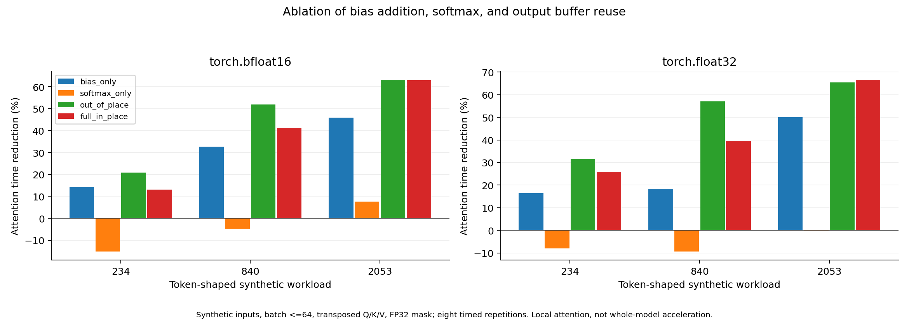
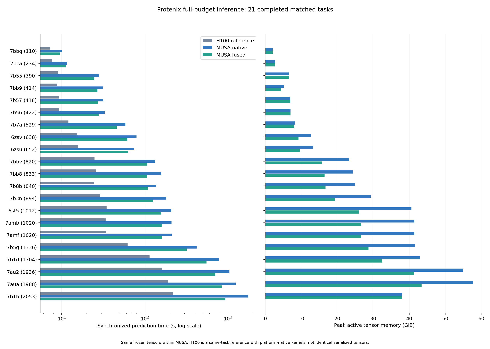

# Protenix在摩尔线程平台上的推理适配与注意力融合优化实验报告

> 实验平台：摩尔线程MTT S5000，NVIDIA H100作为已有基线参照 
> 报告阶段：2026年10月14日至18日 
> 研究对象：Protenix完整结构预测流程 
> 本轮重点：在相同预测预算下，减少推理耗时和显存开销，并检查结构质量

## 一、摘要

本轮从完整模型入手，研究Protenix在摩尔线程平台上的推理开销。前期局部算子实验难以说明实际预测能快多少，因此这次先统一模型、输入和精度设置，再把优化接入完整推理，直接与原生版本及已有H100基线比较。

主要实现是将注意力中的两次加偏置和softmax合并执行，并根据计算精度选择输出缓冲区。实验发现，单纯追求原地写回虽然能够省显存，却会使部分大任务变慢；最终采用BF16独立输出、FP32原地写回的混合方案，在速度和显存之间取得更好的平衡。

|项目|本轮结果|
|---|---|
|真实任务|21条PDB任务，110—2053 tokens，其中20种精确模型输入|
|最终完整模型对照|21条任务×2个版本×6次，共252次正式调用|
|完整预测总耗时|各任务中位数求和，6842.80秒 → 4571.26秒，减少 **33.20%**|
|质量筛查通过子集|20条任务，合计耗时减少 **33.20%**|
|代表任务交替复测|完整预测耗时分别减少5.26%、22.04%、20.86%|
|840-token四路径消融|混合方案耗时减少20.79%，活跃显存峰值减少32.75%|
|质量敏感任务|7bb8追加三个种子复核，原始未通过记录保留，建议继续使用原生路径|
|验证规模|MUSA共647次正式测量调用、160个局部消融场景、843条结构质量评估记录|

上述耗时指完整predict调用，不含模型加载、特征处理和结果导出。结果表明，该优化已经带来完整预测流程的收益；但优化后的摩尔线程结果与H100仍有明显差距，尚不能认为平台间的性能问题已经解决。

## 二、研究目标与实验基础

### 2.1 本轮要解决的问题

本轮关注三个问题：注意力中重复的矩阵读写是否构成实际开销；减少这部分开销后，收益能否延伸到完整预测；不同输入上的速度、显存和结构质量是否能够同时接受。为此，先做局部筛选，再做完整模型消融，最后扩大到21条真实任务。

H100参照采用前期已经完成的21条任务、每条6次正式测量。检查时H100显卡已有其他任务占用，因此本轮沿用已有记录，没有将旧基线计入新增实验工作量。两个平台使用相同模型和生成预算，但分别采用平台支持的内核；跨平台结果用于说明实际系统差距。新增融合本身的收益，则通过同一摩尔线程显卡上的配对实验判断。

### 2.2 数据来源与配置

完整预测使用组内H100基线中的真实PDB输入、52条MSA引用及相应实验参考CIF。原始输入和MSA内容均经过核对。局部算子实验使用固定随机种子的合成张量，作用是拆分优化因素，不能作为真实蛋白预测结果。

|配置项|设置|
|---|---|
|模型|protenix_base_default_v1.0.0|
|预测预算|10轮循环、200步扩散、每次5个候选结构|
|输入信息|使用MSA，不使用模板与RNA MSA|
|计算精度|主干BF16；扩散和置信度模块保留FP32张量；支持的FP32矩阵乘法允许TF32|
|重复测量|各版本独立预热，正式测量6次，取中位数|
|MUSA配对条件|同一冻结输入、同一显卡、每条输入单独启动进程|

去重时发现7amf与7amb的模型输入特征完全相同，所以保留21条任务与原基线对应，同时报告去重后的结果。去重后20种输入的合计耗时减少33.49%；未做同源聚类，因此20种输入不等于20个统计独立的蛋白样本。

## 三、环境适配与优化实现

### 3.1 先修正精度设置和运行问题

环境检查发现，原代码中用于关闭混合精度的上下文写为CUDA，在MUSA上没有按预期生效，导致扩散和置信度模块实际使用BF16。这会使配置相同的两次实验在计算精度上并不一致。因此先增加进程内兼容适配，再用实际模块输出检查精度，确认主干为BF16、扩散和置信度输出为FP32。

大输入还曾出现GPU利用率归零、预测长时间停滞的现象。调用栈落在注意力矩阵乘法和muDNN内核启动附近，但独立矩阵实验没有复现同样的问题，因此没有直接认定是某个矩阵尺寸导致。最终通过每条输入独立进程，并在大于1024 tokens的输入中增加主干循环边界同步完成恢复；原生和优化版本使用相同设置，预测预算不变。

### 3.2 合并加偏置与softmax

原生注意力先计算分数矩阵，再依次加两项偏置、执行softmax，最后与value矩阵相乘。中间几步会反复读取和写回较大的分数矩阵。本轮将两次加偏置和softmax合并为一个内核，两侧矩阵乘法仍采用原实现。

融合内核按行读取分数，在片上完成加偏置、求最大值、指数和归一化，最后写回结果。每次加法仍按原分数类型舍入；大矩阵使用64位地址计算。小尺寸、不支持的布局和训练场景保留原生路径。该方法属于推理算子融合与中间存储优化，不涉及修改模型结构或减少计算轮数。

### 3.3 根据实测调整存储策略

最初采用全部原地写回的方案，确实减少了显存，但在1336-token任务上，完整预测反而慢了5.40%。这说明“少申请一个缓冲区”并不必然更快。进一步比较后，最终采用混合策略：BF16分数使用独立输出，FP32分数使用原地输出。

相同矩阵形状下，两份BF16矩阵的字节数等于一份FP32矩阵，因此BF16独立输出仍可能保留较好的显存表现。最终选择依据完整模型实测，而非仅根据缓冲区数量推断。

## 四、实验设计与方案筛选

### 4.1 从局部筛选到完整模型

先完成联合投影32个场景及偏置融合的精度配置筛选。联合投影在多数场景下变慢，未接入最终模型。之后将注意力拆成仅融合偏置、仅融合softmax、完整融合但独立输出、完整原地融合四种候选，与原生实现比较。

局部消融覆盖8种尺寸、2种精度、2种布局和5个版本，共160个场景，全部通过设定的数值门槛。每个场景预热后保留8次测量，并打乱执行顺序。这组实验用于判断收益来自哪一部分；完整模型收益另行测量。针对大输入停滞，另做8组矩阵精度与布局探针，并验证16个采用真实模型权重的三角计算兼容场景。后者通过局部数值检查，但未部署到最终主实验，不能计为整模型优化收益。

完整模型测量按用途统计如下。各组另行预热，预热和停滞等待不计入次数；最终性能结论仅使用252次主实验。

|实验组|正式调用次数|
|---|---:|
|最终21任务配对主实验|252|
|精度修正后的探索与配置对照|213|
|混合方案三输入多种子补测|27|
|原地与混合方案交替复测（含负对照）|112|
|四路径完整模型消融|24|
|大输入恢复验证|1|
|质量敏感任务追加复核|18|
|合计|647|

### 4.2 四种存储路径的完整预测对照

在840-token真实任务上，比较原生、原地融合、独立输出融合和混合融合四条路径，每条正式测量6次，并交替安排执行顺序。

|版本|完整预测/秒|耗时减少|活跃显存峰值/GiB|显存减少|
|---|---:|---:|---:|---:|
|原生|136.543|0.00%|24.914|0.00%|
|原地融合|131.985|3.34%|16.755|32.75%|
|独立输出融合|106.965|21.66%|25.587|-2.70%|
|混合融合|108.156|20.79%|16.755|32.75%|

独立输出融合的速度略好，但显存峰值高于原生；混合方案保留了接近的速度收益，同时将峰值显存降低32.75%，因此作为最终21任务的测试方案。该选择只代表当前环境和任务集，未把单输入最快路径直接当作所有任务的最优实现。

### 4.3 控制执行顺序和精度影响

完整模型主实验的每条输入都单独启动进程，避免上一任务留下的状态影响下一条。另选三条任务进行ABBA/BAAB交替复测，每个版本各8次；并使用110-token回退任务作为负对照。三个代表任务还分别使用三个随机种子检查性能和结构质量。

TF32另做独立对照，只改变是否允许TF32，不改变新增融合。实际设备内核记录确认了FP32和TF32路径的区别，避免仅凭配置开关判断精度。

|输入|关闭TF32/秒|允许TF32/秒|耗时减少|平均lDDT变化|
|---|---:|---:|---:|---:|
|7bca|15.440|11.990|22.35%|-0.000048|
|6zsv|88.087|80.753|8.33%|0.000124|
|7b8b|161.971|135.669|16.24%|-0.000049|

TF32用于支持的FP32矩阵乘法，模型仍是混合精度执行。下文原生版和混合融合版均允许TF32，所以两者差值不包含切换TF32带来的收益。

## 五、完整模型性能与显存结果

### 5.1 21条真实任务结果

计时前后均同步GPU，统计完整predict调用；加载权重、特征处理、导出和质量评估不计入。下表为每条任务6次正式测量的中位数。显存采用框架记录的活跃分配峰值；耗时和显存减少比例均以MUSA原生版为分母，负值表示变差。

|输入|tokens|H100参照/秒|MUSA原生/秒|MUSA混合/秒|耗时减少|显存减少|
|---|---:|---:|---:|---:|---:|---:|
|7bbq|110|7.25|10.00|9.44|5.60%|0.00%|
|7bca|234|7.66|11.64|11.30|2.92%|0.00%|
|7b55|390|8.94|28.27|24.65|12.81%|-0.01%|
|7bb9|414|8.80|31.25|26.93|13.82%|17.19%|
|7b57|418|9.29|31.61|27.26|13.78%|0.00%|
|7b56|422|9.37|32.78|28.27|13.75%|0.00%|
|7b7a|529|12.05|58.30|45.73|21.56%|2.65%|
|6zsv|638|15.31|79.56|61.76|22.37%|27.42%|
|6zsu|652|15.81|74.24|63.09|15.02%|27.93%|
|7bbv|820|24.75|133.16|106.69|19.88%|32.47%|
|7bb8|833|25.98|158.53|105.91|33.19%|32.57%|
|7b8b|840|24.72|136.58|108.44|20.60%|32.75%|
|7b3n|894|28.93|180.50|126.37|29.99%|33.75%|
|6st5|1012|34.64|207.69|158.42|23.72%|35.61%|
|7amb|1020|33.70|209.24|159.15|23.94%|35.76%|
|7amf|1020|33.91|210.65|159.93|24.08%|35.76%|
|7b5g|1336|62.01|418.25|318.48|23.85%|31.13%|
|7b1d|1704|114.16|787.67|551.97|29.92%|24.63%|
|7au2|1936|159.65|1041.13|702.75|32.50%|24.66%|
|7aua|1988|190.02|1240.92|844.12|31.98%|24.70%|
|7b1b|2053|219.07|1760.82|930.61|47.15%|0.00%|

7bbq为110-token小任务，两个版本均回退原生路径。表中该行的计时差异不应归因于融合；专门的交替负对照结果见下一节。

每条任务各取一次中位数后求和，MUSA耗时由6842.80秒降至4571.26秒，减少33.20%。这相当于清单中每个任务各运行一次，不是对21个百分比直接求平均，也不是并行实验的实际等待时间。排除质量敏感的7bb8后，其余20条任务的合计耗时减少33.20%。

同清单H100参照合计1046.00秒。MUSA耗时相对H100高出的比例由554.19%降至337.02%。当前优化缩小了系统差距，但尚未追平H100。两个平台的三角计算路径和软件栈不同，且旧H100基线未保存本轮相同的冻结特征，因此这不是严格隔离硬件因素的比较。

显存收益具有任务差异。840-token任务的四路径消融下降明显，但最大2053-token任务的活跃峰值没有降低，说明优化后其他中间张量也可能决定总峰值。不能把某个样本的显存降幅套用到所有输入。

### 5.2 交替顺序复测

|输入|原生/秒|混合融合/秒|耗时减少|计时bootstrap 95%区间|正收益交替块|
|---|---:|---:|---:|---|---:|
|7b8b|136.010|107.636|20.86%|20.84%—20.89%|4/4|
|7bca|11.834|11.212|5.26%|4.40%—6.57%|4/4|
|6zsv|80.771|62.967|22.04%|21.98%—22.12%|4/4|

三条任务在四个交替块中均更快，支持收益并非单纯由执行顺序造成。110-token回退负对照的变化为-4.27%，区间为-10.71%—5.06%，包含零，未确认加速。因此小任务的几个百分点差异仍需谨慎解释。上述区间仅描述重复计时波动，不代表对新蛋白的泛化能力。

### 5.3 收益主要来自哪里

对840-token任务做独立模块计时，结果如下。每版只做一次带分析工具的调用，用于解释收益，不混入主实验计时。

|模块|原生/秒|混合融合/秒|模块耗时减少|
|---|---:|---:|---:|
|主干（含MSA和嵌入）|105.899|77.809|26.53%|
|扩散采样|24.799|24.780|0.08%|
|置信度计算|4.753|4.348|8.53%|

主干耗时减少约26.53%，是该输入总收益的主要来源；扩散阶段基本没有变化，说明融合没有均匀加速所有模块。早期原地融合的单块内核诊断中，设备内核事件由498个降至490个，内核总耗时由170.88毫秒降至163.32毫秒；这项局部证据只用于解释减少启动和读写的机制。

## 六、结构质量验证与适用范围

### 6.1 三个代表任务的多种子结果

结构质量使用PXMeter与对应实验参考结构比较。主表评估各次预测的原始生成索引0，最终置信度排名第一的结构另行记录，避免混用。lDDT用于描述结构相似程度，DockQ用于界面质量。评估环境先通过原结构和固定扰动结构自检，再批量计算。

工程筛查预设为平均lDDT下降不超过0.005，有界面时平均DockQ下降不超过0.02。三个代表任务、三个种子的配对结果均通过该门槛。

|输入|种子|原生平均lDDT|混合平均lDDT|lDDT变化|DockQ变化|
|---|---:|---:|---:|---:|---:|
|7bca|101|0.764160|0.764254|0.000094|0.000153|
|7bca|203|0.767981|0.768020|0.000039|0.000800|
|7bca|307|0.759540|0.759472|-0.000068|-0.000104|
|6zsv|101|0.858853|0.858569|-0.000283|0.000008|
|6zsv|203|0.880694|0.880619|-0.000075|-0.000001|
|6zsv|307|0.879340|0.879384|0.000044|-0.000000|
|7b8b|101|0.839294|0.839292|-0.000002|-0.000001|
|7b8b|203|0.846647|0.846795|0.000148|0.000019|
|7b8b|307|0.840674|0.840642|-0.000032|-0.000011|

### 6.2 质量敏感任务的追加复核

21条主任务中，20条通过筛查。7bb8在种子101下平均lDDT下降0.00693，超过门槛，因此增加203、307和409三个种子，每个版本各测量3次。新增配对仍使用同卡和相同冻结输入。

|种子|每版次数|原生平均lDDT|混合平均lDDT|lDDT变化|筛查结果|
|---|---:|---:|---:|---:|---|
|101|6|0.904864|0.897937|-0.006927|需保留观察|
|203|3|0.896477|0.896411|-0.000066|通过|
|307|3|0.901490|0.901691|0.000201|通过|
|409|3|0.901149|0.900869|-0.000280|通过|

新增三个种子均未超门槛，四个种子等权平均的lDDT变化为-0.001768，说明最初下降并非在所有种子上稳定出现。但原种子的结果仍需保留，不能因为追加复测较好就改写成“全部通过”。当前保守建议是7bb8继续使用原生路径，其余通过筛查的任务进入更大范围验证。

这类工程检查能够发现明显风险，但尚不构成生物学等价或正式非劣效证明。同一种子的重复调用主要反映运行波动，不能作为独立种子或独立蛋白扩大样本量。

## 七、阶段结论与后续工作

本轮完成了从环境适配、局部候选筛选到完整预测验证的实验流程。最终混合融合在21条任务上的合计中位耗时减少33.20%，代表任务的交替复测保持正收益；同时，通过四路径消融明确了速度与显存之间的取舍，避免只凭局部最快结果选择方案。

本轮也保留了几项边界：联合投影多数场景退化；全部原地融合在部分任务上变慢；小尺寸回退任务未确认加速；最大输入没有获得峰值显存下降；一个任务仍存在种子相关的质量风险。这些结果限定了当前方案的使用范围。

下一步适合围绕两个方向继续：一是针对H100与MUSA之间仍然明显的主干差距，分析矩阵乘法和三角计算路径；二是扩大真实任务与独立随机种子覆盖，确认混合策略的质量稳定性。本轮仅研究推理，没有测试训练加速。

本轮实验及追加复核已完成。MUSA共647次正式测量，累计有效预测计时约32.09 GPU小时；这是多卡累计计算时间，不是个人工时，也不包含无输出的停滞等待。

逐任务重复值、显存、质量和特征核对见[正式对照数据](逐输入正式对照.csv)，四路径和多种子结果分别见对应CSV。环境、运行方法与文件位置集中在[复现实验说明](复现实验说明.md)。精度修正前的旧结果保留作诊断，未计入本报告正式收益。
